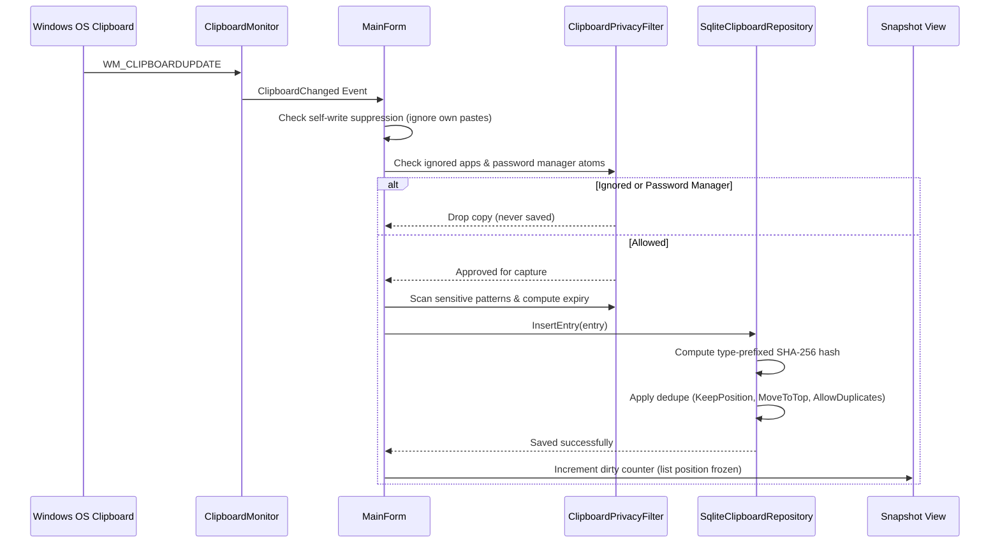
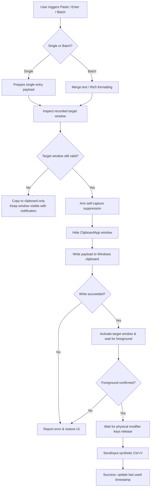
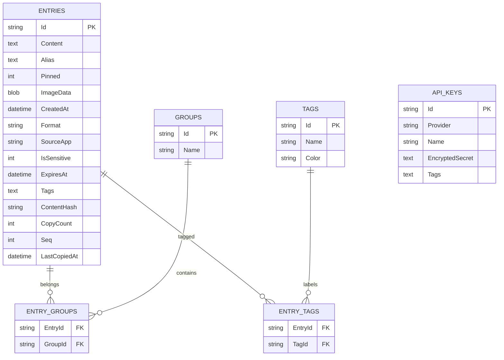
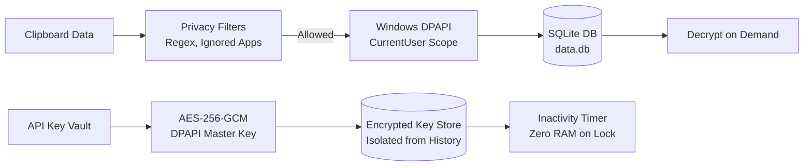
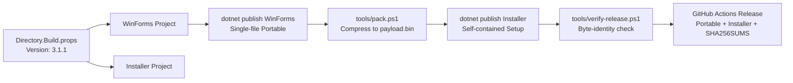

# System Architecture (`ARCHITECTURE.md`)
> **1-Line Summary:** Plain-English visual map of how ClipboardApp works, why each component was chosen, and step-by-step recipes for extending the codebase safely.

## 1. High-Level Visual System Map

```mermaid
flowchart TB
    subgraph UI["UI Layer — WinForms Owner-Drawn"]
        MF["MainForm<br/>Lifecycle, state coordinator, snapshot"]
        MU["MainForm.Ui<br/>Layout, theme, view switcher"]
        MP["MainForm.Paste<br/>Target verification, batch paste, drag-drop"]
        MD["MainForm.Dialogs<br/>Settings, context menu, editor"]
        MFil["MainForm.Filters<br/>Date, type, app, tag filters"]
        Cards["ModernCardList & GridCardList<br/>Owner-drawn card & tile views"]
        Inspect["RichPreviewPanel<br/>Inspector, transform staging"]
        Style["UiStyler & ModernPalette<br/>Fluent, Acrylic, Classic, Native themes"]
    end

    subgraph Core["Core Engine — Domain Services"]
        Monitor["ClipboardMonitor<br/>Win32 clipboard listener"]
        Paste["PasteService & BatchPasteService<br/>Target verification & SendInput"]
        Rich["RichMergeService & PasteTargetInspector<br/>Multi-format merge & target probing"]
        Search["SearchService & FilterService<br/>Debounced text, regex, tag filtering"]
        Tags["TagSuggestionService & TextTransformService<br/>Tag frequency & transform pipeline"]
        Identity["ClipboardContentIdentity<br/>Type-prefixed SHA-256 dedupe"]
    end

    subgraph Security["Storage & Security Layer"]
        Repo["SqliteClipboardRepository<br/>Local SQLite history store"]
        Vault["ApiKeyRepository & ApiVaultService<br/>AES-256-GCM encrypted secret store"]
        DPAPI["DataProtector<br/>Windows DPAPI CurrentUser"]
        Privacy["ClipboardPrivacyFilter<br/>Ignored apps, sensitive data, password atoms"]
    end

    subgraph Infra["Infrastructure & OS Interop"]
        Native["NativeMethods<br/>Win32 P/Invoke, DWM, user32, ole32"]
        Target["TargetWindowTracker<br/>Foreground window inspection"]
        Settings["Settings<br/>Persistent JSON configuration"]
        Program["Program & HotkeyManager<br/>Single-instance guard & global hotkeys"]
    end

    MF --> Monitor
    MF --> MU & MP & MD & MFil
    MU --> Cards & Inspect & Style
    MP --> Paste & Rich & Target
    MD --> Tags
    MFil --> Search
    MF --> Repo & Privacy & Settings
    Repo --> DPAPI
    Vault --> DPAPI
    Paste --> Native
    Target --> Native
    Program --> MF
```



---

## 2. Tech Stack & Why We Chose It

| Layer | Technology | Plain-English Reason Why |
| :--- | :--- | :--- |
| **Runtime & Language** | C# on .NET 8 (`net8.0-windows`) | High-performance native Windows interop, self-contained single-file publishing, zero runtime installation needed by users. |
| **User Interface** | Windows Forms (WinForms) + Owner-Drawn Controls | Instant cold startup (<200ms), low memory footprint (<40MB), zero Chromium or WebView2 runtime dependency. |
| **Local Storage** | SQLite via `Microsoft.Data.Sqlite` | ACID-compliant, zero-configuration local database for indexed search and history persistence without server overhead. |
| **Data Encryption** | Windows DPAPI (`DataProtectionScope.CurrentUser`) | Transparent encryption-at-rest keyed strictly to the logged-in Windows user account. |
| **API Secret Vault** | AES-256-GCM with DPAPI-wrapped Master Key | Isolated secure storage for sensitive API keys with auto-locking and memory wiping on idle. |
| **OS Interop** | Win32 P/Invoke via `NativeMethods` | Direct control over Windows clipboard sequences, `SendInput` keyboard simulation, target window hierarchy, and hotkeys. |
| **Packaging & CI** | GitHub Actions Cloud Pipeline | Cloud-built portable `.exe` and setup installer built strictly from tagged source code; zero binaries committed to Git. |
| **Automated Testing** | xUnit Test Suite (116 tests) | Enforces regressions prevention across SQLite storage, interop struct sizes, dedupe hashing, and UI contracts. |

---

## 3. Core Subsystems & Engineering Tricks

### [SUBSYSTEM: Clipboard-Capture-And-Monitoring] | Aliases: capture loop, WM_CLIPBOARDUPDATE, ClipboardMonitor
> **1-Line Summary:** Listens for Windows clipboard updates, filters out password managers and sensitive tokens, and saves encrypted clips without disturbing the user's active reading view.

* **How It Works (Plain English):**
  The app registers as a clipboard format listener via Win32 `AddClipboardFormatListener`. When the user copies text or images anywhere in Windows, `WM_CLIPBOARDUPDATE` fires. Before touching the content, the monitor checks whether the copy came from an ignored app or password manager. If permitted, the content is encrypted via Windows DPAPI and stored in SQLite. Crucially, the visible list is **never reloaded or jumped** during capture; only a background dirty flag and capture counter are incremented.

* **Data Flow Diagram:**


* **Core Tricks & Landmines:**
  * **Freeze the View:** Never call `ReloadSnapshot()` on clipboard capture events. Live re-sorting while reading or selecting causes clicks to misfire.
  * **Coalesced FD Refresh:** An optional "fresh data" refresh is triggered only after a confirmed manual copy, preserving the user's active item selection and scroll position.

* **Code Anchors (Grep Targets):**
  * `src/ClipboardApp.Core/Services/ClipboardMonitor.cs` -> `AddClipboardListener`, `WndProc`
  * `src/ClipboardApp.Core/Services/ClipboardPrivacyFilter.cs` -> `ShouldIgnoreApp`, `DetectSensitive`
  * `src/ClipboardApp.Core/Data/SqliteClipboardRepository.cs` -> `InsertEntry`, `ComputeHash`
  * `src/ClipboardApp.WinForms/MainForm.cs` -> `OnClipboardChanged`, `ReloadSnapshot`

---

### [SUBSYSTEM: Target-Verified-Paste-Engine] | Aliases: paste flow, SendInput, foreground verification, PasteService
> **1-Line Summary:** Verifies that the intended target application truly owns the foreground window before sending synthetic keystrokes, preventing misdirected pastes.

* **How It Works (Plain English):**
  When the user pastes an item (or a batch of merged items), the app identifies the window that was active right before ClipboardApp appeared. It hides ClipboardApp, restores focus to the target, and inspects the Win32 foreground handle. Only when the foreground window is confirmed to match the intended target, and all physical modifier keys are released, does it inject `Ctrl+V` using Win32 `SendInput`.

* **Data Flow Diagram:**


* **Core Tricks & Landmines:**
  * **40-Byte Struct on x64:** The native Win32 `INPUT` struct must be exactly 40 bytes on 64-bit systems. An incorrect union size causes `SendInput` to silently fail with zero keystrokes dispatched.
  * **No Blind Typing:** Never send keystrokes without foreground verification. If the target window closed or lost focus, fallback to standard clipboard copy and notify the user.

* **Code Anchors (Grep Targets):**
  * `src/ClipboardApp.Core/Interop/NativeMethods.cs` -> `SendInput`, `INPUT`, `InputUnion`
  * `src/ClipboardApp.Core/Services/PasteService.cs` -> `PasteToTarget`, `CopyEntry`
  * `src/ClipboardApp.WinForms/MainForm.Paste.cs` -> `ExecutePasteAction`, `VerifyTarget`

---

### [SUBSYSTEM: Data-Model-And-Deterministic-Ordering] | Aliases: SQLite schema, Seq ordering, dedupe modes, ClipboardContentIdentity
> **1-Line Summary:** Maintains deterministic history ordering using auto-incrementing sequence integers and type-prefixed SHA-256 hashes for reliable duplicate handling.

* **How It Works (Plain English):**
  Every captured clipboard entry is assigned an increasing sequence integer (`Seq`). Items are sorted by `Pinned DESC, Seq DESC`. Duplicate detection relies on `ClipboardContentIdentity`, which prefixes hashes with the data type (e.g., `text:`, `image:`, `files:`) before computing SHA-256. The repository supports three user-selected deduplication policies:
  1. **Keep Position (Default):** Existing entry retains its visual index; only copy count and timestamp increase.
  2. **Move to Top:** Entry is assigned a new `Seq = MAX(Seq) + 1` and floats to the top of the history.
  3. **Allow Duplicates:** Every copy creates an independent record.

* **Database Entity Relationship:**


* **Code Anchors (Grep Targets):**
  * `src/ClipboardApp.Core/Data/SqliteClipboardRepository.cs` -> `InitSchema`, `GetEntriesPaged`
  * `src/ClipboardApp.Core/Services/ClipboardContentIdentity.cs` -> `ComputeHash`
  * `src/ClipboardApp.Core/Models/ClipboardEntry.cs` -> `ClipboardEntry`

---

### [SUBSYSTEM: Owner-Drawn-UI-And-View-Parity] | Aliases: ModernCardList, GridCardList, Accessor, RichPreviewPanel
> **1-Line Summary:** Powers both list and tile grid interfaces through a unified command accessor, keeping selection, hotkeys, and actions identical across views.

* **How It Works (Plain English):**
  The user can switch between a high-density vertical list (`ModernCardList`) and a full-width tile grid (`GridCardList`). Rather than branching UI logic throughout the codebase, both controls conform to a single command interface (`MainForm.Accessor`). Keyboard navigation, multi-selection, drag-and-drop, and context menus execute through this shared accessor. An inspector panel (`RichPreviewPanel`) provides syntax-highlighted code preview, image zoom, color swatches, and staged text transformation previews.

* **Core Tricks & Landmines:**
  * **Never Set UserPaint on ModernCardList:** Enabling `ControlStyles.UserPaint` suppresses the native Windows `WM_DRAWITEM` message pipeline, causing the list box to render completely blank until hovered.
  * **Surviving Rebuilds:** Selection state must persist across filtering and background data refreshes. Checked IDs are retained and matched against visible items.

* **Code Anchors (Grep Targets):**
  * `src/ClipboardApp.WinForms/Controls/ModernCardList.cs` -> `OnDrawItem`, `OnMeasureItem`
  * `src/ClipboardApp.WinForms/Controls/GridCardList.cs` -> `OnPaint`, `OnMouseDown`
  * `src/ClipboardApp.WinForms/Controls/RichPreviewPanel.cs` -> `SetEntry`, `ApplyTransformPreview`
  * `src/ClipboardApp.WinForms/MainForm.Ui.cs` -> `SetupLayout`, `SwitchViewMode`

---

### [SUBSYSTEM: DPAPI-Encryption-And-API-Key-Vault] | Aliases: data protection, secrets vault, auto-lock, ApiVaultService
> **1-Line Summary:** Secures all clipboard history with Windows DPAPI and provides an isolated AES-256-GCM vault for developer API tokens that never enters search history.

* **How It Works (Plain English):**
  All stored text content and image binaries are encrypted with `DataProtector` using Windows DPAPI tied to the current Windows user identity. For high-value developer API keys, a dedicated `ApiVaultService` provides AES-256-GCM authenticated encryption behind a separate master password or DPAPI-wrapped key. API keys never appear in normal clipboard history, cannot be found via global search, and automatically lock after an inactivity timer, wiping key material from RAM.

* **Security Boundaries:**


* **Code Anchors (Grep Targets):**
  * `src/ClipboardApp.Core/Security/DataProtector.cs` -> `Protect`, `Unprotect`
  * `src/ClipboardApp.Core/Security/ApiVaultService.cs` -> `EncryptSecret`, `DecryptSecret`, `Lock`
  * `src/ClipboardApp.Core/Data/ApiKeyRepository.cs` -> `SaveKey`, `GetKeys`

---

### [SUBSYSTEM: Build-Packaging-And-Installer-Verification] | Aliases: portable exe, setup installer, payload.bin, verify-release
> **1-Line Summary:** Compiles single-file portable and setup installer executables in the cloud with byte-for-byte embedded payload verification.

* **How It Works (Plain English):**
  The portable `.exe` is the default deliverable. To produce a setup installer, `tools/pack.ps1` compresses the freshly published portable executable into `payload.bin`. The installer project (`ClipboardApp.Installer`) embeds this exact binary. The verification script `tools/verify-release.ps1` extracts and decompresses the embedded payload to mathematically prove it is byte-identical to the portable release before publishing.

* **Build Pipeline Flow:**


* **Code Anchors (Grep Targets):**
  * `Directory.Build.props` -> `<Version>`
  * `tools/pack.ps1` -> GZip compression stream
  * `tools/build_releases.ps1` -> `BuildInstaller`
  * `tools/verify-release.ps1` -> `ExtractPayload`, SHA-256 verification
  * `.github/workflows/build.yml` -> CI/CD packaging pipeline

---

## 4. Verification & Health Checks

### [VERIFY: Release-Readiness-And-Health-Checks] | Aliases: test suite, build check, verify release, health floor
> **1-Line Summary:** Mandatory commands to verify compiler health, run the 116 automated tests, package deliverables, and verify release payload integrity.

* **Type Check & Compilation (Release):**
  ```powershell
  dotnet build ClipboardApp.sln -c Release
  ```
  *(Expected: 0 Errors, 0 Warnings).*

* **Automated Unit & Contract Test Suite:**
  ```powershell
  dotnet test ClipboardApp.sln -c Release
  ```
  *(Expected: 116 tests passed).*

* **Local Dual Packaging (Portable + Setup Installer):**
  ```powershell
  powershell -ExecutionPolicy Bypass -File .\tools\build_releases.ps1 -BuildInstaller
  ```

* **Cryptographic Byte-Identity Verification:**
  ```powershell
  powershell -ExecutionPolicy Bypass -File .\tools\verify-release.ps1
  ```
  *(Expected: Passes payload extraction, SHA-256 matching, and assembly version stamping).*

---

## 5. Recipes: How to Add New Things Safely

* **Recipe 1: Adding a New Clipboard Format**
  1. Add format identifier in `src/ClipboardApp.Core/Models/ClipboardEntry.cs` -> `Format`.
  2. Implement reading logic in `src/ClipboardApp.Core/Services/ClipboardMonitor.cs` -> `ReadClipboardContent`.
  3. Implement writing logic in `src/ClipboardApp.Core/Services/PasteService.cs` -> `SetClipboardData`.
  4. Register hashing logic in `src/ClipboardApp.Core/Services/ClipboardContentIdentity.cs` -> `ComputeHash`.
  5. Add a roundtrip serialization test in `tests/ClipboardApp.Tests/StorageTests.cs`.

* **Recipe 2: Adding a New Text Transformation Action**
  1. Add transform function in `src/ClipboardApp.Core/Services/TextTransformService.cs`.
  2. Wire the command into the inspector transform dropdown in `src/ClipboardApp.WinForms/Controls/RichPreviewPanel.cs`.
  3. Confirm the preview stages `Save Changes`, `Cancel`, and `Undo` without directly mutating the database.

* **Recipe 3: Adding a Context Menu Action**
  1. Add command enum in `src/ClipboardApp.WinForms/Controls/ContextMenuCommands.cs`.
  2. Add click handler in `src/ClipboardApp.WinForms/MainForm.cs` -> `HandleContextMenuCommand`.
  3. Verify that `Customize` remains the non-hideable, bottom-most menu item.

* **Recipe 4: Adding a New Settings Option**
  1. Add property with default value in `src/ClipboardApp.Core/Models/Settings.cs`.
  2. Add UI toggle control in `src/ClipboardApp.WinForms/Forms/OptionsDialog.cs`.
  3. Wire save and reload events in `src/ClipboardApp.WinForms/MainForm.cs` -> `ApplySettings`.

---

*Related Documents: [Product Intent](PRODUCT.md) · [Decisions & Traps](DECISIONS_AND_TRAPS.md) · [Visual Guide](VISUAL_GUIDE.html) · [Build Pipeline](BUILD.md) · [UI/UX](UI_UX.md)*
