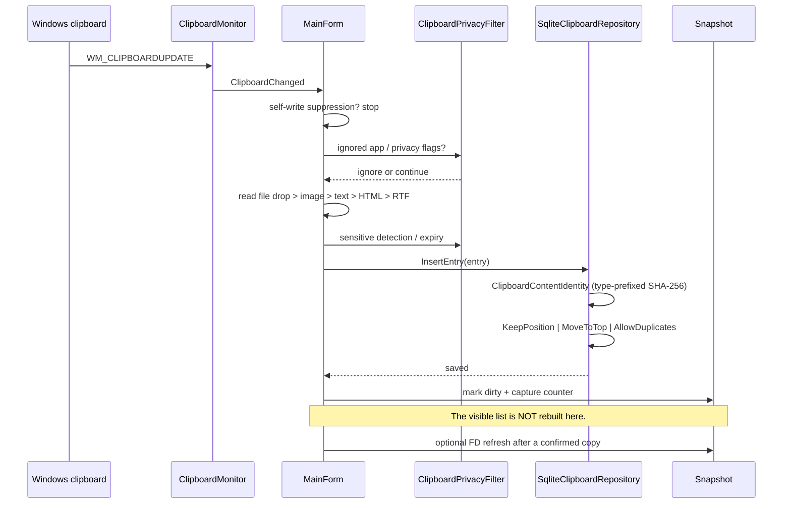
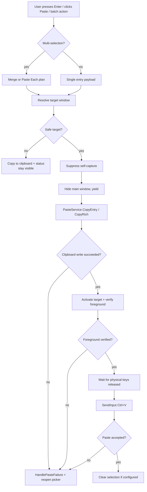
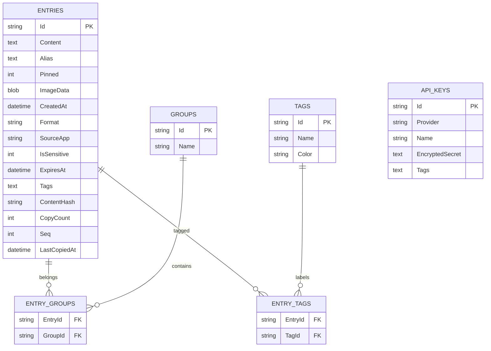
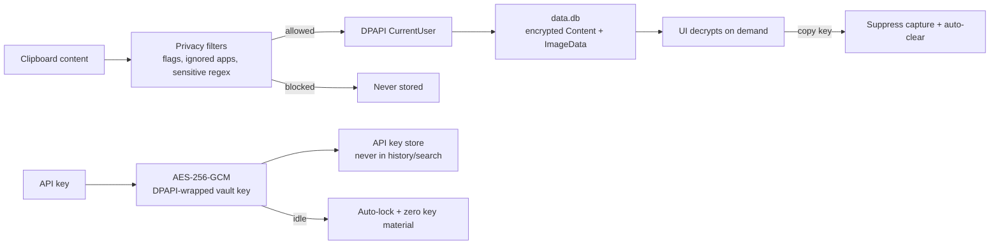
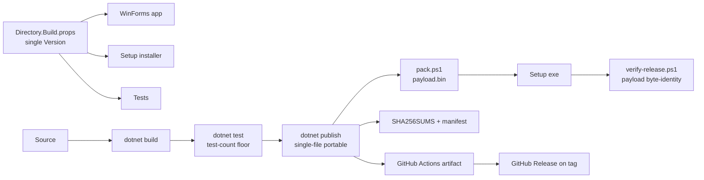

# Architecture & System Design (`ARCHITECTURE.md`)

> **1-Line Summary:** How ClipboardApp is put together — the layers, the data and paste flows, the security boundaries, and the non-obvious tricks that keep it fast and predictable.

## 1. Tech Stack

| Layer | Technology | Why It Is Here |
| :--- | :--- | :--- |
| Language / runtime | C# on .NET 8 (`net8.0-windows`) | Modern Windows APIs, single-file publish, strong tooling |
| UI | Windows Forms + owner-drawn controls | Fast startup, low memory, no WebView/Chromium dependency |
| Data | SQLite via `Microsoft.Data.Sqlite` | Local, transactional, queryable history without a server |
| Encryption | Windows DPAPI (`DataProtectionScope.CurrentUser`) | Data at rest is bound to the current Windows user |
| API vault | AES-256-GCM + DPAPI-wrapped key + optional PBKDF2 | Separate high-value secret store with timed unlock |
| Interop | Win32 P/Invoke in `NativeMethods` | Clipboard formats, foreground checks, `SendInput`, hotkeys, DWM |
| Packaging | `dotnet publish` single-file + PowerShell pipeline | Portable `.exe` by default; verifiable setup on demand |
| CI | GitHub Actions on `windows-latest` | Builds/tests the portable binary from source, never commits it |
| Tests | xUnit | Unit coverage for storage, interop layout, gestures, filters, UI contracts |

## 2. System Layers

```mermaid
flowchart TB
    subgraph UI["UI — WinForms"]
        MF["MainForm<br/>capture, snapshot, lifecycle"]
        MU["MainForm.Ui<br/>layout, theme, view switch"]
        MP["MainForm.Paste<br/>paste, batch, drag, target"]
        MD["MainForm.Dialogs<br/>menu, editor, options"]
        MFil["MainForm.Filters<br/>date/type/app filters"]
        Cards["ModernCardList / GridCardList"]
        Inspect["RichPreviewPanel / ImagePreview"]
        Chrome["FilterPillBar / TrayIcon / HotkeyCaptureBox"]
        Style["UiStyler / ModernPalette / MessageDialog"]
    end

    subgraph Core["Core — services and domain"]
        Monitor["ClipboardMonitor"]
        Paste["PasteService / BatchPasteService / BatchCopyService"]
        Rich["RichMergeService / PasteTargetInspector"]
        Search["SearchService / FilterService"]
        Tags["TagSuggestionService / TextTransformService"]
        Identity["ClipboardContentIdentity"]
        Export["ExportImportService"]
        Hotkey["HotkeyParser"]
    end

    subgraph Data["Storage and security"]
        Repo["SqliteClipboardRepository"]
        Vault["ApiKeyRepository / ApiVaultService"]
        DPAPI["DataProtector"]
        Privacy["ClipboardPrivacyFilter"]
    end

    subgraph Infra["Infrastructure"]
        Native["NativeMethods"]
        Target["TargetWindowTracker"]
        Settings["Settings / Directory.Build.props"]
        Program["Program / HotkeyManager / AppVersion"]
    end

    MF --> Monitor
    MF --> MU
    MF --> MP
    MF --> MD
    MF --> MFil
    MU --> Cards
    MU --> Inspect
    MU --> Chrome
    MU --> Style
    MP --> Paste
    MP --> Rich
    MP --> Target
    MD --> Tags
    MFil --> Search
    MF --> Repo
    Repo --> DPAPI
    Vault --> DPAPI
    MF --> Privacy
    Paste --> Native
    Target --> Native
    MF --> Settings
    Program --> MF
    Program --> Hotkey
```



## 3. Capture Flow



**Trick:** The capture path never reads the database back into the list. That is what keeps the UI from jumping while the user is reading or selecting. `ReloadSnapshot` is the only full read path; the FD refresh is the one deliberate, coalesced exception.

## 4. Paste Flow



**Trick:** A clipboard write is not proof of a paste. The app verifies foreground ownership and the `SendInput` result before declaring success. If anything is uncertain, it copies the payload and keeps the window visible instead of guessing.

## 5. Data Model and Ordering



* New row: `Seq = MAX(Seq) + 1`.
* Sort: `Pinned DESC, Seq DESC`.
* `KeepPosition` (default): recopy updates `CopyCount` / `LastCopiedAt` only.
* `MoveToTop`: recopy assigns a new `Seq`.
* `AllowDuplicates`: always inserts a new row.
* `ContentHash` is type-prefixed SHA-256 from `ClipboardContentIdentity`; only the repository decides duplicates.

## 6. UI Composition and View Parity

* `MainForm.Ui.cs` builds the shell: header/search, type pills, permanent filter row, split view, batch bar, footer.
* `ModernCardList` is a native owner-drawn `ListBox`; `GridCardList` is a `ScrollableControl` tile renderer. Both expose the same selection, activation, drag, and context-menu contracts.
* `MainForm.Accessor` is the only surface used by commands. Add a method to the accessor instead of branching on `ViewMode` at each call site.
* `RichPreviewPanel` owns the inspector and the transform-preview staging (`Save Changes`, `Cancel`, `Undo`).
* `ThumbnailCache` decodes image thumbnails lazily, preserves aspect ratio (letterbox), and evicts with an LRU bound.
* `UiStyler` applies Fluent / Acrylic / Classic / Native tokens to forms, menus, inline controls, and `MessageDialog`. Native restores standard Windows chrome.

## 7. Security Boundaries



* Database and settings live under `%LocalAppData%\ClipboardApp\`, not roaming `%AppData%`.
* Password-manager privacy atoms and the ignored-app list are checked before capture.
* Sensitive clips are masked in the list/inspector and expire after `AutoClearSensitiveMinutes`.
* API keys are stored in a separate encrypted repository and never enter history, search, or batch copy.
* The app never logs clipboard content to the crash log.

## 8. Build, Version, and Release



* Version is defined once in `Directory.Build.props`; never hard-code it in a project file or script.
* `tools/build_releases.ps1` enforces a minimum test count, regenerates the installer payload from the just-built portable, and writes `sha256sum`-compatible checksums.
* `tools/verify-release.ps1` proves the installer payload matches the portable and checks the stamped version.
* `releases/` and `publish/` are gitignored. GitHub Actions builds the portable binary; release binaries are attached to GitHub Releases, not committed.

## 9. Subsystem Tricks and Landmines

| Area | Trick / Rule | Why It Matters |
| :--- | :--- | :--- |
| Native list painting | Never set `ControlStyles.UserPaint` on `ModernCardList` | It suppresses the native `WM_DRAWITEM` path and produces a blank list until hover |
| x64 input | `INPUT` / `InputUnion` must size to 40 bytes on x64 | A 32-byte struct makes `SendInput` silently return 0 |
| Double-click | Detect inside the control; activate on the second mouse-up | Avoids the form hiding mid-gesture and duplicate activation |
| Target focus | Verify foreground/root before `Ctrl+V` | Prevents pasting into the wrong or stale window |
| Drag | Manual arming + 8 px threshold | Drag must not steal clicks, checkboxes, marquee, or double-click |
| Snapshot | Capture writes only; `ReloadSnapshot` is the single read path | Keeps selection and scroll stable |
| Selection | Checked IDs survive refresh/filter; prune to existing | Multi-select must not evaporate on rebuild |
| Images | `ThumbnailCache` letterboxes; never stretch | Screenshots must stay recognizable |
| Rich merge | Inspect target class before writing HTML/RTF/images | Plain editors get text, not corrupt binary payloads |
| Context menu | `customize` is non-hideable and always last | User can always recover a hidden command |
| Filters | Delete only visible filtered IDs | Hidden checked items must not be deleted by surprise |
| API vault | Modeless, timed unlock, zero memory on close | Usable without weakening the secret boundary |
| Versioning | One `Version` property | Prevents app/installer/test drift |
| Installer | Regenerate payload from the portable; verify byte-identity | A fresh clone can rebuild and prove the setup matches |
| Encoding | Keep UTF-8; use `tools/fix-encoding.ps1` if mojibake appears | Windows-1252 round-trips corrupt emoji, quotes, and box drawing |

## 10. How to Extend Safely

1. **New clipboard format:** add capture + write support in `PasteService` and `ClipboardContentIdentity`; update `ClipboardEntry.Format`; add a test that round-trips the payload.
2. **New context-menu command:** add a `ContextMenuCommand` in `ContextMenuCommands.All`, handle it in `MainForm.ShowContextMenu`, and ensure `NormalizeOrder` accepts it. Keep `customize` last.
3. **New settings toggle:** add the property + normalization in `Settings`, expose it in `OptionsDialog`, and add a default-value/smoke test.
4. **New card action:** add it to `MainForm.Accessor` so both list and grid views route through one surface.
5. **New transform:** add it to `TextTransformService`, wire it into the preview menu, and test the preview/save/cancel contract.
6. **New dialog:** set `Owner`, suspend/restore `TopMost`, and apply `UiStyler.ApplyForm`.
7. **New release step:** update `build_releases.ps1`, `verify-release.ps1`, and the changelog together; never hand-edit hashes.

## 11. Verification

```powershell
dotnet build ClipboardApp.sln -c Release
dotnet test ClipboardApp.sln -c Release
.\tools\build_releases.ps1 -BuildInstaller
.\tools\verify-release.ps1
```

Expected current state: **0 warnings / 0 errors**, **116/116 tests**, portable + setup artifacts, payload byte-identity verified.

---

*Related: [Product Intent](PRODUCT.md) · [Decisions & Traps](DECISIONS_AND_TRAPS.md) · [Visual Guide](VISUAL_GUIDE.html) · [Build Pipeline](BUILD.md) · [UI/UX](UI_UX.md) · [Subsystem Dossiers](subsystems/01-pasting-and-focus.md)*
